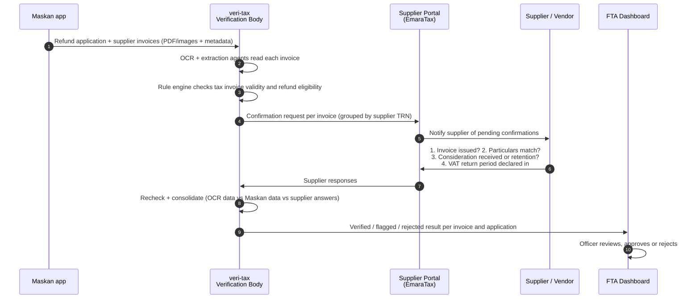
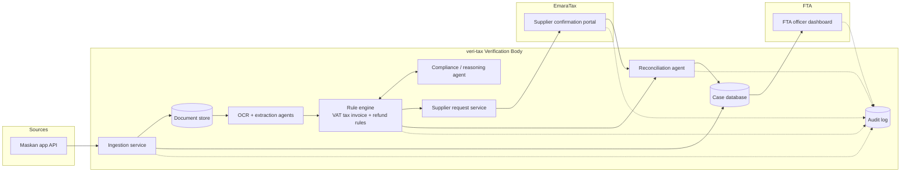

# veri-tax

**A verification body for VAT refund claims raised through the Maskan app and the EmaraTax portal.**

veri-tax sits between the applicant (a UAE national claiming a VAT refund on building a new residence), the suppliers who issued the tax invoices, and the Federal Tax Authority (FTA). It pulls supplier invoices from Maskan, checks them automatically against the UAE VAT refund rules, asks each supplier to confirm its invoices through an EmaraTax-facing portal, reconciles the answers, and shows the result to FTA officers on a dashboard.

> **Status:** v0.1 baseline. The verification body API (FastAPI) and the **veri-tax portal** (`web/`, React) run end to end on synthetic data: ingest → rules → supplier confirmation → reconciliation → officer decision. The portal holds both user-facing frontends (the EmaraTax supplier portal and the FTA officer dashboard) plus a Maskan simulator. See [Getting started](#getting-started), [CHANGELOG.md](CHANGELOG.md) and the [roadmap](#roadmap).

## Getting started

Requires Python 3.11+ and [uv](https://docs.astral.sh/uv/).

```bash
cp .env.example .env        # optional; defaults work for local dev
uv sync
uv run uvicorn app.main:app --reload --port 8000
```

- Interactive API docs: http://localhost:8000/docs
- On first start the database (SQLite, `veritax.db`) is seeded with 3 synthetic applications and 4 suppliers (`app/seed.py`). Delete `veritax.db` to reseed.
- Mock auth: supplier endpoints take an `X-Supplier-TRN` header (e.g. `100111111100003`); FTA endpoints take an `X-Officer-Id` header.
- Tests: `uv run pytest`

### The portal (`web/`)

Requires Node 22+. Build it once and FastAPI serves it at http://localhost:8000/portal/ (and `/` redirects there):

```bash
cd web && npm ci && npm run build
```

For frontend work, run the Vite dev server instead. It serves the portal on http://localhost:3000/portal/ with hot reload and proxies the API to `:8000` (override with `VERITAX_API`):

```bash
cd web && npm run dev
```

- Sign in on the home page with a demo supplier (the seeded TRNs) or the demo officer. Sign-in is a stand-in for EmaraTax / UAE PASS and FTA SSO: it only sets the mock headers above.
- **Supplier portal** (`/portal/supplier`): queue of confirmation requests under the supplier's TRN; the four questions plus the declaration per invoice; bulk confirm for invoices issued and paid as submitted; CSV template download and upload, checked row by row in the browser and saved all-or-nothing.
- **FTA dashboard** (`/portal/fta`): overview (refund totals, new applications, applications by status, invoice outcomes, top rule failures, supplier response rate and time); applications with filters held in the URL and CSV export; application detail with rule results and evidence, the submitted-vs-confirmed comparison, a recommended outcome, the officer decision and the audit trail; supplier search and detail; rejections by rule, status, supplier and emirate.
- **Maskan simulator** (`/portal/maskan`): submit a test application with invoices and watch it go through the pipeline.
- Portal checks: `npm test` (unit tests for CSV, VAT period and formatting helpers) and `npm run build` (type check + bundle).

| Path | What |
|------|------|
| `app/main.py` | FastAPI app, CORS, router wiring |
| `app/models.py` | Tables and status enums (the [data model](#data-model)) |
| `app/schemas.py` | Request bodies (API contract) |
| `app/rules.py` | Versioned rule engine: `TI-*`, `NR-*`, `SC-*` |
| `app/pipeline.py` | Ingest → rules → confirmation requests → reconcile → application rollup |
| `app/api/maskan.py` | `POST /maskan/applications` (Maskan ingestion) |
| `app/api/supplier.py` | `/supplier/*` (EmaraTax supplier portal) |
| `app/api/fta.py` | `/fta/*` (FTA officer dashboard) |
| `app/api/meta.py` | `GET /meta/rules`: the rule catalog the portal uses to label rule IDs |
| `app/seed.py` | Synthetic fixtures |
| `web/src/pages/supplier/` | Supplier portal: queue, confirmation form, CSV upload |
| `web/src/pages/fta/` | FTA dashboard: overview, applications, application detail, suppliers, rejections |
| `web/src/pages/maskan/` | Maskan simulator |
| `web/src/lib/` | API-independent helpers (CSV, VAT periods, formatting, status vocabulary) |

Working on the repo: see [CONTRIBUTING.md](CONTRIBUTING.md) for branches (`Suhayl`, `Haaziq`, `Aaron`) and the PR flow.

---

## Contents

1. [Why it exists](#why-it-exists)
2. [End-to-end flow](#end-to-end-flow)
3. [Components](#components)
4. [Verification rules](#verification-rules)
5. [Supplier confirmation (EmaraTax portal)](#supplier-confirmation-emaratax-portal)
6. [FTA dashboard](#fta-dashboard)
7. [Statuses](#statuses)
8. [Data model](#data-model)
9. [Planned repository layout](#planned-repository-layout)
10. [Security and audit](#security-and-audit)
11. [Roadmap](#roadmap)
12. [Open questions](#open-questions)
13. [References](#references)

---

## Why it exists

A New Residence VAT refund claim rests on supplier tax invoices. Checking them today means manual review of scanned documents, and there is no structured way to confirm with the supplier that:

- it really issued the invoice, with the same particulars the applicant submitted,
- the consideration was received, or is being held as retention, and
- it declared the output VAT in a named VAT return period.

veri-tax automates the document checks and turns the supplier confirmation into a structured step, so FTA officers see one consolidated, evidence-backed record per invoice, application and supplier.

---

## End-to-end flow



### Step by step

| # | Stage | Owner | Output |
|---|-------|-------|--------|
| 1 | **Ingest.** Pull each new or updated refund application and its supplier invoices from Maskan. | Maskan connector | `Application`, `Invoice` records plus raw documents |
| 2 | **Extract.** OCR and extraction agents read every invoice into structured fields (TRN, invoice no., dates, amounts, VAT, plot, description). | OCR / extraction agents | `ExtractedInvoice` with a confidence score per field |
| 3 | **Verify.** The rule engine checks each invoice against the tax invoice requirements and the refund eligibility rules. | Rule engine + compliance agent | `RuleResult[]`, invoice status `AUTO_VERIFIED`, `NEEDS_SUPPLIER` or `AUTO_REJECTED` |
| 4 | **Request confirmation.** One confirmation request per invoice is sent to the supplier portal, grouped under the supplier's TRN. | Supplier request service | `ConfirmationRequest` |
| 5 | **Supplier responds.** The supplier confirms issuance and particulars, states whether consideration was received or is retention, and names the VAT return period. | Supplier (EmaraTax) | `SupplierResponse` |
| 6 | **Recheck and consolidate.** Three sources are compared: the Maskan data, the OCR data and the supplier's answers. Any mismatch is flagged. | Reconciliation agent | `VerificationOutcome` per invoice, rolled up per application |
| 7 | **Publish to FTA.** Results and evidence go to the FTA dashboard, where an officer makes the final decision. | FTA dashboard | Officer decision, audit trail |

---

## Components



| Component | Responsibility |
|-----------|----------------|
| **Maskan connector / ingestion service** | Pulls applications and invoices from Maskan by polling or webhook. Deduplicates by invoice hash and supplier TRN plus invoice number. Stores originals unchanged. |
| **OCR + extraction agents** | Turn PDFs and photos (English and Arabic) into structured invoice fields, with a confidence score per field. Fields below the confidence threshold go to the rule engine as `UNCERTAIN`, never as guessed values. |
| **Rule engine** | Deterministic, versioned checks (see [Verification rules](#verification-rules)). Every result carries the rule ID, the rule version and the evidence it used. |
| **Compliance / reasoning agent** | Handles cases the deterministic rules cannot settle, such as whether a description covers eligible building works or whether a document is a tax invoice at all. It returns a recommendation with reasons and never makes the final decision. |
| **Supplier request service** | Creates confirmation requests, groups them by supplier TRN, sends reminders and tracks SLAs and expiry. |
| **Supplier confirmation portal (EmaraTax)** | Front end where suppliers sign in with their EmaraTax identity and confirm or dispute each invoice. See [Supplier confirmation](#supplier-confirmation-emaratax-portal). |
| **Reconciliation agent** | Compares Maskan data, OCR data and supplier answers. Checks the declared VAT return period against the invoice date. Produces the final verification outcome. |
| **FTA dashboard** | Officer-facing views for applications, suppliers, refunds and rejections. See [FTA dashboard](#fta-dashboard). |
| **Audit log** | Append-only record of every automated and human decision. |

---

## Verification rules

Rules are grouped and versioned so the engine can show which rule set a decision was made under. The list below is the starting set; each rule must be confirmed against the current FTA guide (VATGRH1, revised April 2026) and the VAT Executive Regulation before it goes live.

### A. Tax invoice validity

| ID | Check |
|----|-------|
| `TI-01` | The document is a tax invoice: it is titled "Tax Invoice", not a quotation, proforma or receipt. |
| `TI-02` | It shows the supplier's name, address and TRN. |
| `TI-03` | The supplier TRN is valid and was active on the invoice date. |
| `TI-04` | It shows the invoice number and the date of issue. |
| `TI-05` | It describes the goods or services supplied. |
| `TI-06` | It shows the taxable amount, the VAT rate and VAT amount, and the total, in AED. |
| `TI-07` | The arithmetic adds up: taxable amount × rate = VAT amount, and taxable amount + VAT = total, within a rounding tolerance. |
| `TI-08` | The recipient is the applicant. If the invoice is addressed to a contractor, consultant, agent or related party, it states that it is for the applicant's use and shows the plot or address. |

### B. Refund eligibility (New Residence)

| ID | Check |
|----|-------|
| `NR-01` | The invoice shows the plot number or residence address, and it matches the application. |
| `NR-02` | The goods or services are eligible: building works or materials for the residence, not excluded items such as furniture or electrical appliances. |
| `NR-03` | The invoice date falls within the construction period and before completion, except retention invoices. |
| `NR-04` | The claim is lodged within 12 months of the residence's completion date (Executive Regulation Article 66(3)). |
| `NR-05` | The invoice has not been claimed in another application. This catches duplicates across applications and across applicants. |
| `NR-06` | Where an intermediary is the recipient, it confirms that it is not recovering input VAT on the invoice. |
| `NR-07` | Retention invoices are only accepted in a retention claim and need proof of payment. |

### C. Supplier confirmation and reconciliation

| ID | Check |
|----|-------|
| `SC-01` | The supplier confirms it issued the invoice. |
| `SC-02` | The particulars the supplier confirms (number, date, amounts, VAT) match the OCR data and the Maskan data. |
| `SC-03` | The supplier states the consideration was **received**, or that the amount is **retention** (with the retention amount and expected release date). |
| `SC-04` | The supplier names the VAT return period in which it declared the output VAT. |
| `SC-05` | The declared period is consistent with the invoice date and the payment date (date of supply rules). |
| `SC-06` | Optional, once FTA data access is agreed: the declared period's return has been filed. |

Each rule returns `PASS`, `FAIL`, `UNCERTAIN` or `NOT_APPLICABLE`, together with its evidence.

---

## Supplier confirmation (EmaraTax portal)

Suppliers see a queue of invoices issued under their TRN that are awaiting confirmation. For each invoice the portal shows what the applicant submitted, including the extracted particulars and the original document, and asks:

1. **Did you issue this tax invoice?** Yes or No. Answering No ends the check and flags the invoice as `DISPUTED`.
2. **Do the particulars match what you issued?** The supplier confirms invoice number, date, taxable amount, VAT amount and total, and can correct any field. Every correction is kept as a mismatch for the FTA.
3. **Consideration status.** Either:
   - *Received in full*, with the date received, or
   - *Partly received or retention*, with the amount received, the amount retained and the expected release date.
4. **VAT return period.** The tax period in which the invoice was included in the supplier's VAT return, for example `2026-Q2` or `Apr-2026`.
5. **Declaration.** The supplier confirms that the information is correct, and the response is timestamped and tied to the signed-in EmaraTax user.

Suppliers can respond to invoices one by one or in bulk, with a CSV upload for large contractors. Requests expire after a set SLA; after the reminders run out, an expired invoice is flagged `NO_SUPPLIER_RESPONSE`.

---

## FTA dashboard

The dashboard is for FTA officers only and is read-mostly; the officer's approve and reject actions are the only writes.

### Overview

- New applications today, this week and this month
- Applications by status: in verification, awaiting supplier, ready for decision, approved, rejected
- **Total refunds requested and verified (AED)**, approximate until the officer decides
- Rejected applications and rejected refund value
- Supplier response rate and average time to respond
- Most common rule failures

### Suppliers (vendors)

- **Search** by name, TRN or emirate
- Supplier list with application count, invoice count, total VAT claimed against the supplier's invoices, verified and rejected amounts, response rate and a risk flag
- **Supplier detail** (click a supplier):
  - Number of applications in which the supplier appears
  - Invoices and their statuses
  - **Approximate total refunds** linked to the supplier
  - Rejected and disputed invoices, with reasons
  - VAT return periods the supplier declared
  - Retention amounts outstanding

### Rejected suppliers and rejected refunds

- Suppliers whose invoices were rejected or disputed, with counts, values and reasons
- Rejected refund claims, filterable by reason, rule ID, supplier, emirate and date

### Application detail

- Applicant, plot and completion date
- Every invoice with: the original document, the extracted fields, the rule results, the supplier response and a three-way comparison (Maskan, OCR, supplier)
- Recommended outcome, then the officer's decision and comments
- Full audit trail

### Filters and export

- Date range, emirate, status, supplier, amount band and rule failure
- CSV export for reporting

---

## Statuses

**Invoice**

```
INGESTED → EXTRACTED → AUTO_VERIFIED ─┐
                     → NEEDS_SUPPLIER → AWAITING_SUPPLIER → SUPPLIER_CONFIRMED → RECONCILED ─┤
                                                         → DISPUTED ───────────────────────┤
                                                         → NO_SUPPLIER_RESPONSE ───────────┤
                     → AUTO_REJECTED ───────────────────────────────────────────────────────┤
                                                                                           ▼
                                                                    VERIFIED | FLAGGED | REJECTED
```

**Application:** `RECEIVED → IN_VERIFICATION → AWAITING_SUPPLIERS → READY_FOR_DECISION → APPROVED | PARTIALLY_APPROVED | REJECTED`

---

## Data model

Core entities, in outline:

| Entity | Key fields |
|--------|-----------|
| `Applicant` | id, Emirates ID (hashed), name, Maskan reference |
| `Application` | id, applicant_id, plot_no, emirate, completion_date, claim_type (`NEW_RESIDENCE` \| `RETENTION` \| `ADDITION`), status, submitted_at |
| `Supplier` | TRN, legal name, address, EmaraTax account id, risk_flag |
| `Invoice` | id, application_id, supplier_trn, invoice_no, invoice_date, taxable_amount, vat_amount, total, currency, plot_no, description, document_uri, document_hash, status |
| `ExtractedInvoice` | invoice_id, field → {value, confidence}, model_version |
| `RuleResult` | invoice_id, rule_id, rule_version, result, evidence |
| `ConfirmationRequest` | id, invoice_id, supplier_trn, sent_at, due_at, reminders, status |
| `SupplierResponse` | request_id, issued, particulars_confirmed, corrections, consideration_status, amount_received, retention_amount, retention_release_date, vat_return_period, declared_by, declared_at |
| `VerificationOutcome` | invoice_id, outcome, reasons[], eligible_vat_amount |
| `OfficerDecision` | application_id, officer_id, decision, approved_amount, comments, decided_at |
| `AuditEvent` | actor, action, entity, before, after, at |

---

## Planned repository layout

> **Current layout:** this repo is the verification body (`app/`, flat FastAPI package) plus one web portal (`web/`) that holds both the supplier portal and the FTA dashboard behind role-based routes. The tree below is the longer-term target as services split out.

```
veri-tax/
├── services/
│   ├── ingestion/          # Maskan connector
│   ├── extraction/         # OCR + extraction agents
│   ├── rules/              # Versioned rule engine (TI-*, NR-*, SC-*)
│   ├── agents/             # Compliance + reconciliation agents
│   └── supplier-requests/  # Confirmation requests, reminders, SLAs
├── apps/
│   ├── supplier-portal/    # EmaraTax-facing supplier confirmation UI
│   └── fta-dashboard/      # FTA officer dashboard
├── packages/
│   └── shared/             # Types, schemas, status enums
├── docs/                   # Architecture decisions, rule sources, API contracts
├── fixtures/               # Sample (synthetic) invoices for tests
├── README.md
└── CHANGELOG.md
```

---

## Security and audit

- **Data protection.** Applicant and supplier data is personal and tax-confidential. It is encrypted in transit and at rest, hosted in the UAE, and kept for a defined retention period.
- **Identity.** Suppliers sign in through EmaraTax / UAE PASS, and FTA officers through FTA single sign-on. Access is role-based: a supplier sees only invoices under its own TRN.
- **Human in the loop.** Agents and the rule engine recommend; only an FTA officer approves or rejects a refund.
- **Explainability.** Every outcome links to the rule IDs and versions, the extracted fields with confidence scores, and the supplier response it used.
- **Audit.** An append-only audit log covers every ingest, extraction, rule run, supplier response and officer decision.
- **Model governance.** OCR and LLM model versions are pinned and recorded on every result, and the system is evaluated against a labelled invoice set before each model change.

---

## Roadmap

| Phase | Scope |
|-------|-------|
| **0. Foundations** | Repository structure, shared schemas, synthetic invoice fixtures, CI |
| **1. Ingest + extract** | Maskan connector (or a mock), document store, OCR and extraction with confidence scores |
| **2. Rule engine** | `TI-*` and `NR-*` rules, versioning, evidence capture, duplicate detection |
| **3. Supplier portal** | Confirmation requests, the supplier UI with the four questions, reminders and SLAs |
| **4. Reconciliation** | Three-way comparison, `SC-*` rules, final outcome per invoice and application |
| **5. FTA dashboard** | Overview, supplier search and detail, rejections, application detail, export |
| **6. Hardening** | Security review, audit, load testing, model evaluation, pilot with a small supplier group |

---

## Open questions

- **Maskan integration.** Is there an API with webhooks, or do we poll? What is the document format, and does Maskan pass application metadata (plot, completion date)?
- **EmaraTax integration.** Will the supplier portal be embedded in EmaraTax, linked from it, or standalone with EmaraTax / UAE PASS sign-in?
- **VAT return data.** Can veri-tax check a supplier's filed returns (`SC-06`), or does it rely only on the supplier's declaration?
- **Supplier SLA.** How long does a supplier have to respond, and what happens when it doesn't?
- **Rule source of truth.** Which FTA team signs off the rule set and its updates?
- **Hosting.** UAE cloud region and data residency requirements.

---

## References

- FTA: [VAT Refund for UAE Nationals Building New Residences (service page)](https://tax.gov.ae/en/services/vat.refund.for.uae.nationals.homebuilders.aspx)
- FTA: [UAE Nationals Building New Residences](https://tax.gov.ae/en/taxes/Vat/refunds/uae.nationals.building.new.residences.aspx)
- PwC: [VAT Guide VATGRH1, VAT Refund for UAE Nationals Building Residences (2026)](https://www.pwc.com/m1/en/services/tax/middle-east-tax-news-alerts/2026/uae-vat-refund-nationals-building-residences.html)
- Crowe: [FTA issues revised VAT refund guide for UAE nationals building new residences](https://www.crowe.com/ae/news/fta-issues-revised-vat-refund-guide-for-uae-nationals-building-new-residences)
- Hadef & Partners: [New guide on VAT refunds for UAE nationals building new residences (VATGRH1)](https://hadefpartners.com/news-insights/insights/new-guide-on-vat-refunds-for-uae-nationals-building-new-residences-vatgrh1/)

The rules in this README are a working summary for design purposes. They are not legal or tax advice and must be checked against the current FTA guide before implementation.
